# Estimación de la humedad relativa a partir de la temperatura del aire mediante regresión lineal simple

**Datos:** SIATA, datos validados de agosto de 2026
**Algoritmo:** regresión lineal simple (mínimos cuadrados ordinarios)
**Reproducción:** `uv run python main.py` (sin argumentos) regenera todas las cifras, tablas y figuras citadas.
**Pruebas:** `uv run pytest`.

---

## 1. Introducción

El Valle de Aburrá cuenta con una red de estaciones del SIATA que registra variables meteorológicas y de calidad del aire cada hora. Este informe usa los datos validados de agosto de 2026 para construir y explicar, paso a paso, un modelo de aprendizaje automático sencillo e interpretable. Se da prioridad al desarrollo matemático manual con datos reales, de modo que cada cálculo pueda verificarse en papel y contrastarse con la ejecución en Python.

## 2. Definición del problema y objetivo

**Pregunta de investigación.** ¿Qué tan bien puede estimarse la humedad relativa horaria de una estación a partir de la temperatura del aire medida en la misma estación y a la misma hora?

**Objetivo práctico.** Disponer de una estimación sencilla de la humedad relativa para (a) rellenar de forma provisional horas en que el higrómetro falle y (b) servir como control de calidad cruzado entre dos sensores de la misma estación.

| Elemento | Definición |
|---|---|
| Variable dependiente Y | Humedad relativa, `relative_humidity` (%) |
| Variable independiente X | Temperatura del aire, `air_temperature` (°C) |
| Alcance | Estación con código `BAR-PDLA`, datos horarios del 1 al 31 de agosto de 2026 |
| Horizonte de predicción | 0 horas (estimación simultánea): en la hora *t* se usa la temperatura medida en *t*, que ya está disponible en ese momento. No es un pronóstico del futuro. |

**Justificación física.** La humedad relativa es el cociente entre la presión de vapor real y la presión de vapor de saturación, y esta última crece con la temperatura (relación de Clausius–Clapeyron). Si el contenido de vapor cambia poco durante el día, la humedad relativa baja cuando la temperatura sube. Por eso se espera una relación fuerte y negativa. La temperatura no contiene a la humedad relativa ni se calcula a partir de ella: son dos sensores distintos, así que no hay fuga del objetivo.

**Por qué no otras combinaciones.** PM2.5 es una fracción de PM10, y NOx = NO + NO2, de modo que usar una para predecir la otra revelaría parcialmente el objetivo. Ozono frente a temperatura también mostró correlación positiva (r medio 0,80 en las 8 estaciones que miden ozono, con los datos de todo el mes; 0,82 usando solo el 1–24 de agosto), pero es menor que la de temperatura y humedad (r entre −0,88 y −0,94) y depende de procesos fotoquímicos más difíciles de explicar con un solo predictor.

## 3. Descripción del conjunto de datos y variables

**Fuente:** <https://siata.gov.co/IDEAM/DatosValidados_agosto2026.zip> (descargado el 19/10/2026, 4,6 MB).

**Estructura real del archivo** (verificada en el código y en `results/tables/raw_column_summary.csv`):

- 1 ZIP con una carpeta `Datos/` y **152 archivos `.xls`** (Excel 97-2003), uno por variable y estación.
- Los 152 archivos tienen **exactamente las mismas 8 columnas**, una sola hoja y **744 filas** (31 días × 24 h).
- Al unirlos se obtienen **113 088 registros**, **30 estaciones** y **14 variables**.

| Columna original | Tipo | Faltantes | Descripción | Decisión |
|---|---|---|---|---|
| `NombreEstacion` | texto | 0 | Código de estación (p. ej. `BAR-PDLA`) | Se conserva como `station` |
| `Variable` | texto | 0 | Nombre de la variable | Se traduce al inglés como `variable` |
| `Unidad` | texto | 0 | Unidad de medida | Se conserva como `unit` |
| `FechaInicio` | texto | 0 | Inicio de la hora (`dd/mm/aaaa hh:mm:ss am/pm`) | Se convierte a fecha como `start_time` |
| `FechaFin` | texto | 0 | Fin de la hora | Se elimina: en los 113 088 registros es exactamente `FechaInicio` + 1 h |
| `FechaModificacion` | texto | 1 818 (1,61 %) | Fecha de la última validación | Se elimina: es metadato de auditoría |
| `Concentracion` | real | 5 166 (4,57 %) | Valor medido (para todas las variables, no solo contaminantes) | Se conserva como `value` |
| `MSFLCode` | texto | 50 592 (44,74 %) | Código de sensor meteorológico; vacío en contaminantes | Se elimina: es redundante con `Variable` |

**Variables disponibles** (`results/tables/variable_summary.csv`):

| Variable | Unidad | Estaciones | Registros | Faltantes (%) | Mínimo | Mediana | Máximo |
|---|---|---|---|---|---|---|---|
| pm25 | µg/m³ | 23 | 17 112 | 6,11 | 0,12 | 13,00 | 72,40 |
| air_temperature | °C | 14 | 10 416 | 2,87 | 10,77 | 22,80 | 32,28 |
| relative_humidity | % | 14 | 10 416 | 2,88 | 9,63 | 66,28 | 100,00 |
| pressure | hPa | 14 | 10 416 | 2,87 | 745,49 | 845,96 | 869,37 |
| precipitation | mm | 14 | 10 416 | 0,00 | 0,00 | 0,00 | 22,36 |
| wind_speed | m/s | 14 | 10 416 | 2,87 | 0,08 | 1,45 | 6,84 |
| wind_direction | grados | 14 | 10 416 | 2,87 | 6,28 | 129,33 | 322,55 |
| ozone | µg/m³ | 9 | 6 696 | 1,43 | 0,00 | 35,31 | 149,11 |
| pm10 | µg/m³ | 9 | 6 696 | 4,23 | 1,00 | 31,00 | 238,00 |
| no2 | ppb | 7 | 5 208 | 6,64 | 0,01 | 17,51 | 67,80 |
| no | ppb | 7 | 5 208 | 7,68 | 0,00 | 6,63 | 181,44 |
| nox | ppb | 7 | 5 208 | 6,64 | 0,76 | 24,24 | 221,59 |
| so2 | ppb | 4 | 2 976 | 8,00 | 0,00 | 2,57 | 55,10 |
| co | ppm | 2 | 1 488 | 61,49 | 0,03 | 0,49 | 3,87 |

El conjunto **no incluye coordenadas, altitud ni nombres completos de las estaciones**, solo códigos. Los prefijos de los códigos (MED, BAR, ITA…) parecen indicar el municipio, pero el dataset no lo documenta, así que no se hace ninguna afirmación geográfica.

**Muestra de registros originales** (`results/tables/raw_sample.csv`, las 10 primeras filas tal como vienen en el ZIP; por el orden alfabético de los archivos corresponden a CO de la estación `GIR-EPM`, no a las variables del modelo):

| NombreEstacion | Variable | Unidad | FechaInicio | FechaFin | Concentracion |
|---|---|---|---|---|---|
| GIR-EPM | CO | ppm | 01/08/2026 12:00:00 am | 01/08/2026 01:00:00 am | 0,492662 |
| GIR-EPM | CO | ppm | 01/08/2026 01:00:00 am | 01/08/2026 02:00:00 am | 0,347234 |
| GIR-EPM | CO | ppm | 01/08/2026 02:00:00 am | 01/08/2026 03:00:00 am | 0,323106 |
| GIR-EPM | CO | ppm | 01/08/2026 03:00:00 am | 01/08/2026 04:00:00 am | 0,467901 |
| GIR-EPM | CO | ppm | 01/08/2026 04:00:00 am | 01/08/2026 05:00:00 am | 0,291179 |
| GIR-EPM | CO | ppm | 01/08/2026 05:00:00 am | 01/08/2026 06:00:00 am | 0,395662 |
| GIR-EPM | CO | ppm | 01/08/2026 06:00:00 am | 01/08/2026 07:00:00 am | 0,570859 |
| GIR-EPM | CO | ppm | 01/08/2026 07:00:00 am | 01/08/2026 08:00:00 am | 0,765012 |
| GIR-EPM | CO | ppm | 01/08/2026 08:00:00 am | 01/08/2026 09:00:00 am | 0,283249 |
| GIR-EPM | CO | ppm | 01/08/2026 09:00:00 am | 01/08/2026 10:00:00 am | 0,244994 |

Nótese que `12:00:00 am` es la medianoche (hora 0) y que `FechaFin` es siempre `FechaInicio` + 1 h. Los 8 registros usados en el desarrollo matemático (sección 7) son datos reales de la estación modelada.

## 4. Análisis exploratorio de datos

### 4.1 Valores faltantes

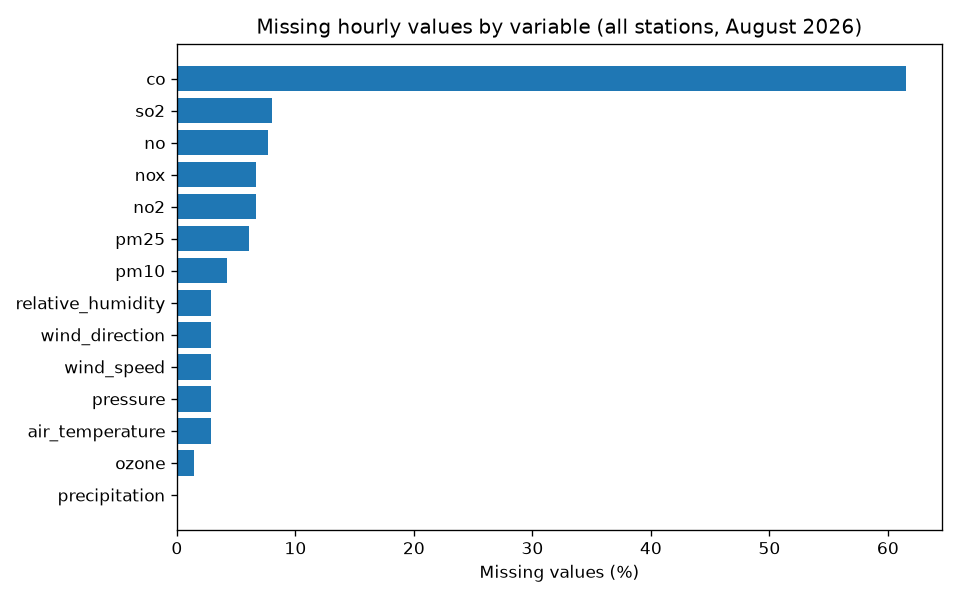

El CO tiene un 61,49 % de horas sin dato, y el resto de las variables está por debajo del 8,1 %. En las seis variables meteorológicas, los faltantes (≈ 299 por variable) se concentran en las estaciones MED-SELE y MED-PROV. En el mes completo tienen 468 y 721 pares temperatura–humedad completos, mientras que casi todas las demás tienen los 744. **La estación BAR-PDLA no tiene ningún faltante** en sus seis variables meteorológicas (744 de 744 horas), lo que evita tener que imputar.

### 4.2 Elección de la estación con evidencia

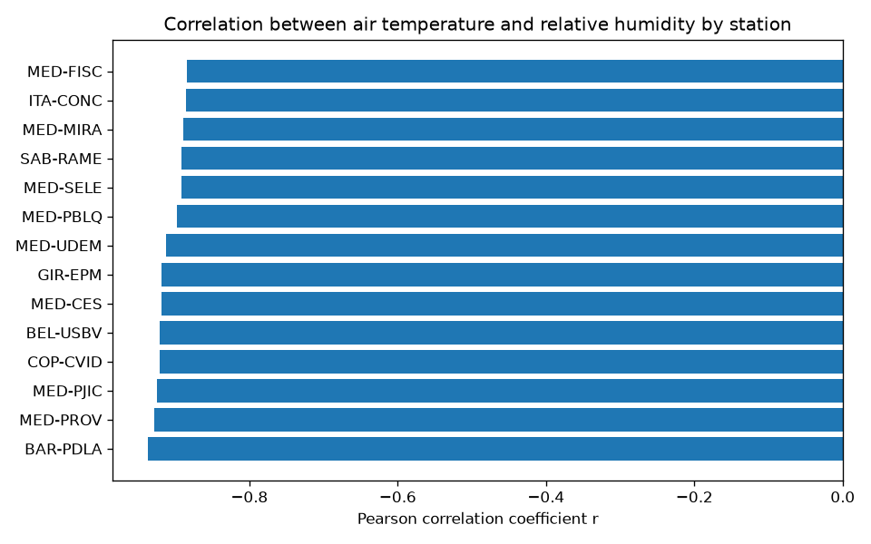

La correlación de Pearson entre temperatura y humedad relativa es negativa y fuerte **en las 14 estaciones meteorológicas** (de −0,8845 a −0,9371), así que la relación no es un artefacto de una sola estación. Para no usar información del periodo de prueba, esta tabla se calculó **solo con datos del 1 al 24 de agosto**. BAR-PDLA tiene la correlación más fuerte (r = −0,9371) con datos completos (576 pares), y por eso se eligió.

No se mezclan estaciones porque la presión registrada va de 745 a 869 hPa según la estación, lo que indica altitudes muy distintas, y la relación temperatura–humedad cambia con la altitud.

### 4.3 Estadística descriptiva de BAR-PDLA (744 h)

| Variable | Media | Desv. estándar | Mínimo | Q1 | Mediana | Q3 | Máximo |
|---|---|---|---|---|---|---|---|
| Temperatura (°C) | 23,75 | 4,29 | 15,63 | 20,03 | 23,10 | 27,80 | 31,58 |
| Humedad relativa (%) | 68,50 | 20,90 | 23,13 | 50,07 | 73,21 | 87,59 | 97,58 |
| Presión (hPa) | 865,81 | 1,61 | 861,23 | 864,66 | 866,11 | 866,92 | 869,37 |
| Velocidad del viento (m/s) | 1,41 | 0,84 | 0,27 | 0,66 | 1,25 | 2,04 | 4,88 |
| Dirección del viento (grados) | 118,32 | 58,54 | 33,37 | 78,23 | 96,63 | 153,96 | 285,62 |
| Precipitación (mm) | 0,05 | 0,31 | 0,00 | 0,00 | 0,00 | 0,00 | 4,11 |

### 4.4 Distribución de la variable objetivo

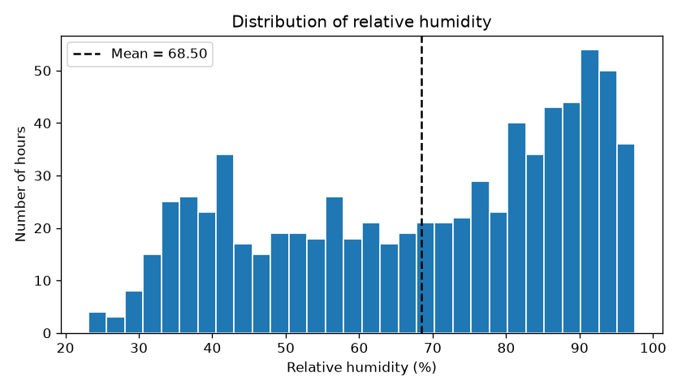

La humedad relativa no es normal: es asimétrica, con más horas en valores altos (mediana 73,21 % > media 68,50 %) y un límite natural cerca del 100 %. La regresión lineal no exige que Y sea normal, solo que los residuos se comporten razonablemente, lo cual se revisa en la sección 9.

### 4.5 Valores atípicos

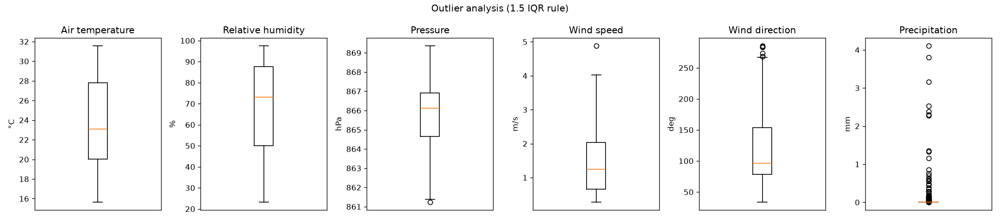

Según la regla de 1,5 × IQR (`results/tables/outlier_summary.csv`), la temperatura y la humedad no tienen ningún valor atípico. Hay 1 en presión, 1 en velocidad del viento, 6 en dirección del viento y **124 en precipitación**. Este último caso muestra por qué la regla no debe aplicarse a ciegas: como más de la mitad de las horas no llueve, Q1 = Q3 = 0, y **toda** hora con lluvia queda marcada como "atípica". Son eventos reales, así que **ningún valor atípico se eliminó**.

### 4.6 Correlaciones (periodo de entrenamiento)

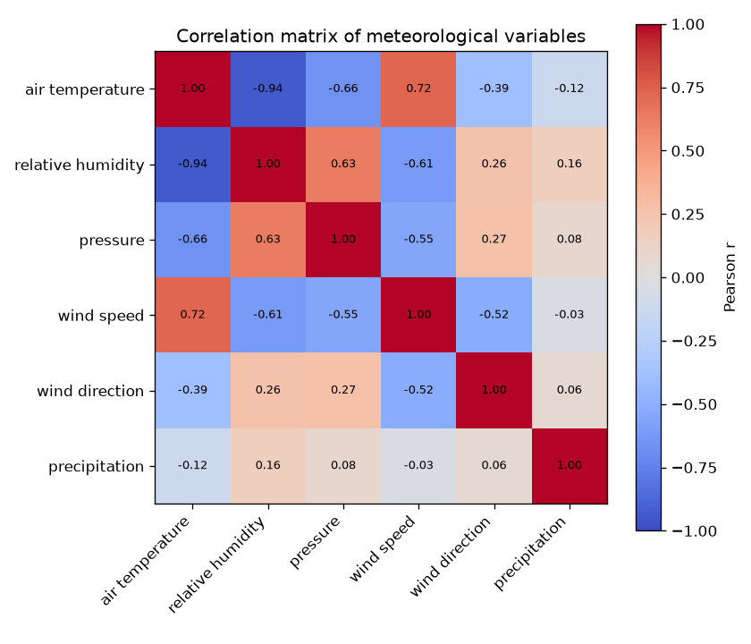

La humedad relativa se relaciona sobre todo con la temperatura (r = −0,94), y luego con la presión (0,63) y la velocidad del viento (−0,61). Pero la temperatura también está correlacionada con el viento (0,72) y con la presión (−0,66). Añadirlas como predictores introduciría colinealidad y aportaría poco, ya que gran parte de su efecto se debe a que todas siguen el mismo ciclo diario. Esto respalda usar un único predictor.

### 4.7 Relación entre predictor y objetivo

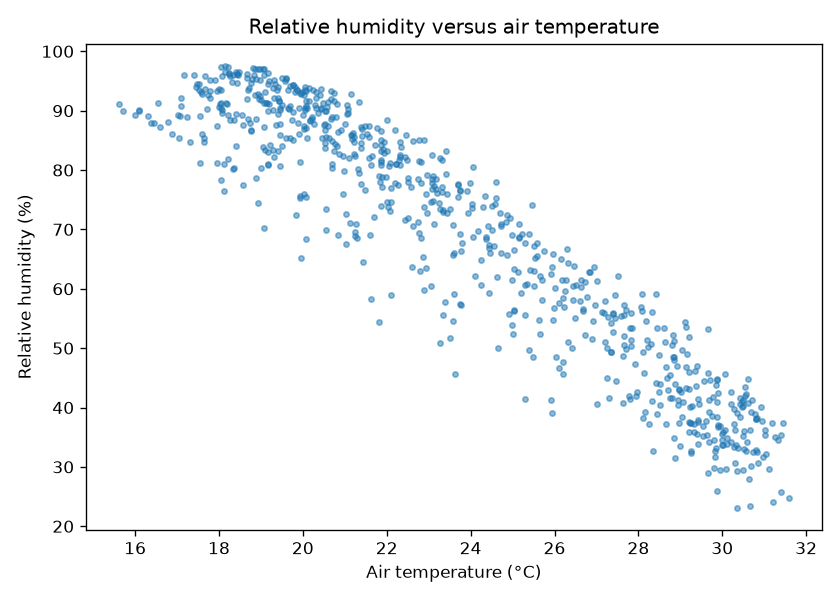

La nube de puntos tiene forma claramente lineal y decreciente. En el extremo frío (< 19 °C) se nota una ligera curvatura: la humedad se aplana porque se acerca a la saturación. Esta limitación de la recta reaparece en la sección 9.

### 4.8 Patrones temporales

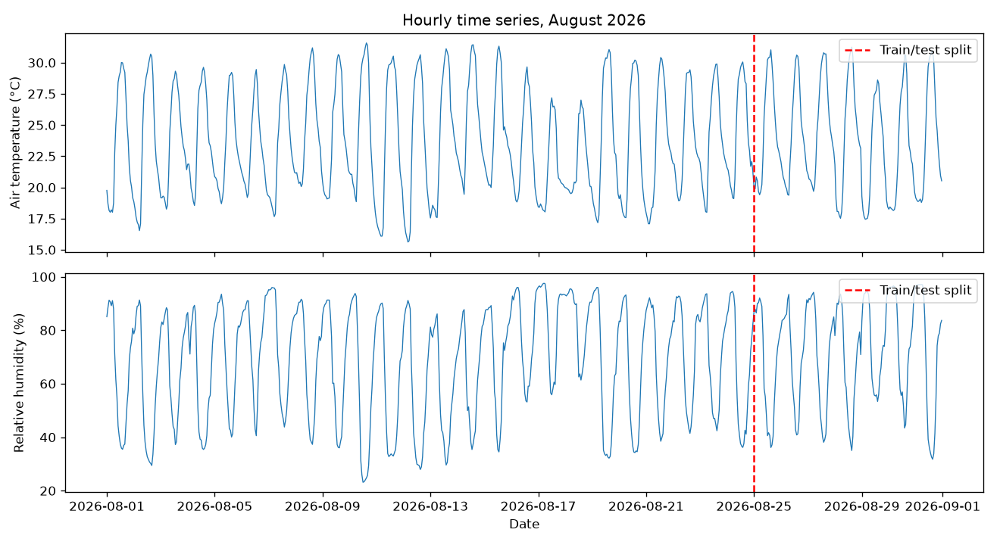

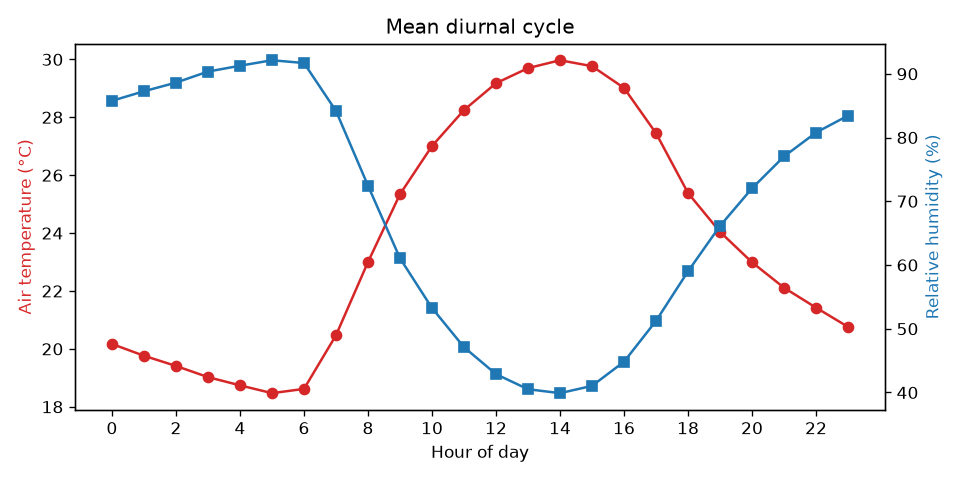

Ambas series tienen un ciclo diario muy marcado y en fase opuesta. En promedio, la temperatura mínima (≈ 18,5 °C) ocurre a las 05:00 y coincide con la humedad máxima (≈ 92 %), y la temperatura máxima (≈ 30 °C) ocurre a las 14:00, junto con la humedad mínima (≈ 40 %). Hay días que se apartan del patrón típico. El 17 y el 18 de agosto tuvieron las temperaturas medias diarias más bajas del mes (21,5 y 22,0 °C) y las humedades medias diarias más altas (83,8 % y 83,4 %). En el sentido contrario, del 10 al 13 de agosto la humedad media diaria fue de 57 a 59 % con temperaturas medias normales (23,1 a 24,4 °C), y el mínimo del mes (23,13 %) se registró el 10 de agosto a las 12:00. El dataset no incluye nubosidad, punto de rocío ni otras variables que permitan explicar la causa de estos días. La línea roja marca la división cronológica entre entrenamiento y prueba.

## 5. Limpieza y preparación de datos

Implementada en `src/data_cleaning.py`. Resumen antes y después (`results/tables/cleaning_summary.csv`):

| Comprobación | Antes | Después |
|---|---|---|
| Registros | 113 088 | 113 088 |
| Columnas | 8 | 5 |
| Valores medidos faltantes | 5 166 | 5 166 |
| Registros duplicados exactos | 0 | 0 |
| Duplicados estación-variable-hora | 0 | 0 |
| Valores físicamente imposibles | 0 | 0 |
| Fin ≠ inicio + 1 h | 0 | — |

**Decisiones y justificación:**

1. **Unión de archivos.** Los 152 archivos tienen columnas idénticas (el cargador lo valida y falla si no es así), así que se concatenaron. Cada archivo corresponde a una combinación distinta de estación y variable, y se comprobó que no hay ninguna clave estación-variable-hora repetida, de modo que la unión no crea duplicados.
2. **Tipos de datos.** Las fechas venían como texto en formato de 12 horas. Se convirtieron con el formato explícito `%d/%m/%Y %I:%M:%S %p`. Los 113 088 registros se convirtieron sin error, entre el 01/08/2026 00:00 y el 31/08/2026 23:00.
3. **Columnas irrelevantes.** Se eliminaron `FechaFin` (redundante), `FechaModificacion` (auditoría) y `MSFLCode` (redundante), y los nombres se tradujeron al inglés.
4. **Unidades.** Cada variable tiene una sola unidad en todas las estaciones, así que no hubo que convertir unidades. Solo se cambió la etiqueta `C` por `°C`.
5. **Valores imposibles.** Se definieron límites puramente físicos: humedad entre 0 y 100 %, dirección del viento entre 0 y 360°, y valores no negativos en todas las variables salvo la temperatura. Si apareciera un valor fuera de rango se convertiría en faltante, pero en estos datos no hubo ninguno. Los 32 valores exactamente iguales a 100 % de humedad (saturación) y los 52 ceros de ozono son físicamente posibles y se conservaron.
6. **Valores faltantes.** **No se imputaron ni se reemplazaron por cero** en el dataset limpio: inventar mediciones sesgaría cualquier análisis posterior, y el 61 % de faltantes del CO no puede rellenarse de forma creíble. Para el modelo se eliminan solo las horas en que falte X o Y. En BAR-PDLA no hay ninguna, así que se usan las 744 horas.
7. **Valores extremos.** No se eliminó ningún valor extremo pero válido (ver sección 4.5).
8. **Normalización.** No se aplicó. Con un solo predictor, la regresión lineal por mínimos cuadrados no la necesita, y mantener las unidades originales hace que la pendiente se interprete directamente en %/°C.

Archivos generados: `data/processed/siata_clean_long.csv` (formato largo, todas las estaciones) y `data/processed/station_BAR-PDLA_hourly.csv` (una columna por variable). El ZIP original en `data/raw/` no se modifica: el cargador lo lee directamente sin extraerlo.

**División entrenamiento/prueba (cronológica, sin mezclar).** Entrenamiento: del 1 al 24 de agosto (576 h, 77 %). Prueba: del 25 al 31 de agosto (168 h, 23 %). El modelo nunca usa horas futuras para ajustarse, y el periodo de prueba es una semana completa con su ciclo diario. Como no hay muestreo aleatorio, no hace falta fijar una semilla.

## 6. Selección y justificación del algoritmo

| Candidato | ¿Encaja con estos datos? |
|---|---|
| **Regresión lineal simple** | **Sí.** Y es numérica continua, la relación con X es lineal (r = −0,94), tiene solución cerrada calculable a mano y sus coeficientes tienen significado físico. |
| Lasso | No aporta: su ventaja es seleccionar variables entre muchos predictores, y aquí hay uno solo. |
| Ridge | No aporta: corrige la colinealidad entre varios predictores, que aquí no existe con un único X. |
| KNN (regresión) | Posible, pero no genera una ecuación interpretable, depende de la elección de *k* y el cálculo manual exige distancias a cientos de puntos. |
| Árbol de decisión | Aproxima una relación lineal con escalones, lo que es menos preciso y menos natural para este patrón. |
| K-means / K-medoids | No aplican: son métodos no supervisados y la pregunta es supervisada (estimar Y). |

Se implementa **únicamente** la regresión lineal simple (`src/model.py`), calculada con las fórmulas cerradas en numpy, sin depender de scikit-learn.

## 7. Desarrollo matemático manual

### 7.1 Modelo y fórmulas

$$\hat{y} = b_0 + b_1 x$$

- $\hat{y}$: humedad relativa estimada (%). $x$: temperatura del aire (°C).
- $b_1$ (pendiente): cambio medio de la humedad, en puntos porcentuales, por cada 1 °C de aumento de temperatura.
- $b_0$ (intercepto): valor de la recta cuando $x = 0$ °C. Es un valor matemático sin sentido físico aquí, porque 0 °C está muy fuera del rango observado (15,6 a 31,6 °C).

Mínimos cuadrados elige $b_0$ y $b_1$ de forma que la suma de errores al cuadrado $SSE = \sum (y_i - \hat{y}_i)^2$ sea mínima. Al derivar e igualar a cero se obtiene:

$$b_1 = \frac{n\sum x_i y_i - \sum x_i \sum y_i}{n\sum x_i^2 - \left(\sum x_i\right)^2}, \qquad b_0 = \bar{y} - b_1 \bar{x}$$

### 7.2 Registros seleccionados

Se tomaron los **8 registros reales del 1 de agosto de 2026 a las 00, 03, 06, …, 21 h** (periodo de entrenamiento). Se eligieron porque cubren un ciclo diario completo, desde la madrugada fría y húmeda hasta la tarde cálida y seca, y por tanto recorren casi todo el rango de X. Al estar espaciados 3 h, además, se reduce la redundancia entre horas consecutivas. **Simplificación explícita:** los valores se redondearon a 2 decimales para poder calcularlos a mano. Todos los cálculos siguientes usan esos valores redondeados.

### 7.3 Tabla de seguimiento (`results/tables/manual_regression_sample.csv`)

| i | Hora | $x_i$ (°C) | $y_i$ (%) | $x_i^2$ | $x_i y_i$ |
|---|---|---|---|---|---|
| 1 | 00:00 | 19,76 | 85,06 | 390,4576 | 1 680,7856 |
| 2 | 03:00 | 18,01 | 90,65 | 324,3601 | 1 632,6065 |
| 3 | 06:00 | 18,75 | 87,98 | 351,5625 | 1 649,6250 |
| 4 | 09:00 | 26,49 | 55,02 | 701,7201 | 1 457,4798 |
| 5 | 12:00 | 29,26 | 37,41 | 856,1476 | 1 094,6166 |
| 6 | 15:00 | 29,54 | 36,94 | 872,6116 | 1 091,2076 |
| 7 | 18:00 | 25,02 | 52,37 | 626,0004 | 1 310,2974 |
| 8 | 21:00 | 20,56 | 73,38 | 422,7136 | 1 508,6928 |
| **Σ** | | **187,39** | **518,81** | **4 545,5735** | **11 425,3113** |

### 7.4 Sustitución numérica

Medias:

$$\bar{x} = \frac{187{,}39}{8} = 23{,}42375 \qquad \bar{y} = \frac{518{,}81}{8} = 64{,}85125$$

Numerador de $b_1$:

$$n\sum xy = 8 \times 11\,425{,}3113 = 91\,402{,}4904$$
$$\sum x \sum y = 187{,}39 \times 518{,}81 = 97\,219{,}8059$$
$$\text{numerador} = 91\,402{,}4904 - 97\,219{,}8059 = -5\,817{,}3155$$

Denominador de $b_1$:

$$n\sum x^2 = 8 \times 4\,545{,}5735 = 36\,364{,}5880$$
$$\left(\sum x\right)^2 = 187{,}39^2 = 35\,115{,}0121$$
$$\text{denominador} = 36\,364{,}5880 - 35\,115{,}0121 = 1\,249{,}5759$$

Pendiente e intercepto (se conservan 6 decimales de $b_1$ para no arrastrar error de redondeo):

$$b_1 = \frac{-5\,817{,}3155}{1\,249{,}5759} = -4{,}655432 \approx -4{,}6554$$
$$b_0 = 64{,}85125 - (-4{,}655432)(23{,}42375) = 64{,}85125 + 109{,}04768 = 173{,}8989$$

**Ecuación ajustada con la muestra manual:**

$$\boxed{\hat{y} = 173{,}8989 - 4{,}6554\,x}$$

Interpretación: según estos 8 registros, cada grado adicional de temperatura se asocia con 4,66 puntos porcentuales **menos** de humedad relativa. Python, con los mismos 8 valores, obtiene $b_0 = 173{,}898923$ y $b_1 = -4{,}655432$ (`results/tables/model_coefficients.csv`), lo que coincide con el cálculo manual.

### 7.5 Errores de predicción en la muestra (`results/tables/manual_sample_errors.csv`)

Ejemplo para i = 1: $\hat{y}_1 = 173{,}8989 - 4{,}6554 \times 19{,}76 = 173{,}8989 - 91{,}9907 = 81{,}91$, y el error es $e_1 = 85{,}06 - 81{,}91 = 3{,}15$.

| i | $x_i$ | $y_i$ | $\hat{y}_i$ | $e_i = y_i - \hat{y}_i$ | $e_i^2$ |
|---|---|---|---|---|---|
| 1 | 19,76 | 85,06 | 81,91 | 3,15 | 9,94 |
| 2 | 18,01 | 90,65 | 90,05 | 0,60 | 0,35 |
| 3 | 18,75 | 87,98 | 86,61 | 1,37 | 1,88 |
| 4 | 26,49 | 55,02 | 50,58 | 4,44 | 19,74 |
| 5 | 29,26 | 37,41 | 37,68 | −0,27 | 0,07 |
| 6 | 29,54 | 36,94 | 36,38 | 0,56 | 0,32 |
| 7 | 25,02 | 52,37 | 57,42 | −5,05 | 25,50 |
| 8 | 20,56 | 73,38 | 78,18 | −4,80 | 23,07 |
| **Σ** | | | | **≈ 0,00** | **80,88** |

La suma de los errores es prácticamente cero, una propiedad de los mínimos cuadrados con intercepto que sirve para comprobar el cálculo. Los errores absolutos más grandes aparecen a las 18:00 (5,05), a las 21:00 (4,80) y a las 09:00 (4,44), es decir, en horas de transición entre el día y la noche. Una hipótesis posible es que en esas horas la temperatura cambia rápido y la humedad no la sigue exactamente de forma lineal; con solo 8 registros de un día esta hipótesis **no se puede comprobar**.

### 7.6 Predicción para una entrada nueva de prueba

Se toma el **primer registro del periodo de prueba**, del 25 de agosto de 2026 a las 00:00, que el modelo no vio durante el ajuste: $x_{nuevo} = 20{,}02$ °C, con humedad real $y = 86{,}95$ %.

- Con la recta manual (8 registros): $\hat{y} = 173{,}8989 - 4{,}6554 \times 20{,}02 = 173{,}8989 - 93{,}2011 = 80{,}70$ %, con un error de $86{,}95 - 80{,}70 = 6{,}25$ puntos.
- Con el modelo entrenado con 576 h: $\hat{y} = 177{,}0926 - 4{,}6139 \times 20{,}02 = 177{,}0926 - 92{,}3703 = 84{,}72$ %, con un error de $2{,}23$ puntos.

### 7.7 Diferencia entre el ejemplo manual y el modelo completo

| Ajuste | n | $b_0$ | $b_1$ |
|---|---|---|---|
| Muestra manual (1 ago, cada 3 h) | 8 | 173,8989 | −4,6554 |
| Entrenamiento completo (1–24 ago) | 576 | 177,0926 | −4,6139 |

El procedimiento es el mismo (las mismas fórmulas en `SimpleLinearRegression.fit`), pero **los datos no lo son**: el modelo completo usa las 576 horas de entrenamiento sin redondear. Por eso los coeficientes se parecen sin ser idénticos. Que la pendiente de un solo día (−4,66) quede tan cerca de la de 24 días (−4,61) indica que la relación es estable. El modelo que se evalúa en la sección 9 es el completo.

## 8. Implementación en Python

El código está organizado en clases pequeñas, una por responsabilidad:

| Archivo | Clase(s) | Responsabilidad |
|---|---|---|
| `src/data_loader.py` | `SiataLoader` | Lee los 152 `.xls` directamente desde el ZIP y valida que todos tengan las mismas columnas. |
| `src/data_cleaning.py` | `DataCleaner` | Renombra, convierte tipos, elimina duplicados, aplica límites físicos y genera la tabla por estación y el resumen de limpieza. Las reglas (nombres, unidades, límites) son atributos de la clase. |
| `src/plotting.py` | `BasePlotter` | Etiquetas de ejes y guardado de figuras, compartidos por las clases que dibujan. |
| `src/eda.py` | `ExploratoryAnalysis` | Tablas descriptivas, valores atípicos, correlaciones y figuras exploratorias. |
| `src/model.py` | `ModelDataPreparer`, `SimpleLinearRegression` | Selección de X e Y, división cronológica y tabla de sumas manual; ajuste por fórmulas cerradas con `fit` y `predict`. |
| `src/evaluation.py` | `RegressionMetrics`, `EvaluationPlotter` | MAE, MSE, RMSE y R², tabla de errores y figuras de evaluación. |
| `main.py` | — | Orquesta todo con `uv run python main.py` (no recibe argumentos). |
| `tests/` | — | 40 pruebas (`uv run pytest`) en `test_data_cleaning.py`, `test_model.py`, `test_eda.py` y `test_reported_results.py`: limpieza con datos sintéticos, cargador, ajuste (comparado con `numpy.polyfit`), división temporal, métricas y coherencia entre las tablas guardadas que cita este informe. |

**Refactorización a clases.** El código se escribió primero con funciones (commit `d733b17`) y luego se pasó a clases (commit `3563eb1`). Se ejecutaron ambas versiones con los mismos datos y **todas las tablas, los datos procesados y las 11 figuras resultaron idénticos byte a byte** (comparación de ambos commits ejecutados con el mismo ZIP; las tablas y figuras de `results/` son las de ambas versiones), de modo que el cambio fue solo de organización y no altera ninguna cifra de este informe.

## 9. Métricas de evaluación y análisis crítico

### 9.1 Fórmulas

$$MAE = \frac{1}{n}\sum |y_i - \hat{y}_i| \qquad MSE = \frac{1}{n}\sum (y_i - \hat{y}_i)^2 \qquad RMSE = \sqrt{MSE} \qquad R^2 = 1 - \frac{\sum (y_i-\hat{y}_i)^2}{\sum (y_i-\bar{y})^2}$$

### 9.2 Cálculo manual de MAE y RMSE (`results/tables/manual_metric_sample.csv`)

Se usan **8 registros reales del periodo de prueba** (25 de agosto, cada 3 h) y las predicciones del **modelo completo**, calculadas con $x$ redondeada a 2 decimales y redondeadas ellas mismas a 2 decimales (por eso la predicción de las 00:00 es 84,72 aquí y 84,71 en `test_predictions.csv`, que usa $x$ sin redondear). Ejemplo para i = 2: $\hat{y} = 177{,}0926 - 4{,}6139 \times 20{,}53 = 177{,}0926 - 94{,}7234 = 82{,}37$.

| i | Hora | $x_i$ | $y_i$ | $\hat{y}_i$ | $e_i$ | $\lvert e_i\rvert$ | $e_i^2$ |
|---|---|---|---|---|---|---|---|
| 1 | 00:00 | 20,02 | 86,95 | 84,72 | 2,23 | 2,23 | 4,9729 |
| 2 | 03:00 | 20,53 | 90,02 | 82,37 | 7,65 | 7,65 | 58,5225 |
| 3 | 06:00 | 19,68 | 90,71 | 86,29 | 4,42 | 4,42 | 19,5364 |
| 4 | 09:00 | 25,71 | 58,19 | 58,47 | −0,28 | 0,28 | 0,0784 |
| 5 | 12:00 | 30,22 | 40,56 | 37,66 | 2,90 | 2,90 | 8,4100 |
| 6 | 15:00 | 31,03 | 36,14 | 33,92 | 2,22 | 2,22 | 4,9284 |
| 7 | 18:00 | 26,72 | 52,26 | 53,81 | −1,55 | 1,55 | 2,4025 |
| 8 | 21:00 | 23,27 | 73,41 | 69,73 | 3,68 | 3,68 | 13,5424 |
| **Σ** | | | | | | **24,93** | **112,3935** |

$$MAE = \frac{24{,}93}{8} = 3{,}1163 \text{ puntos de humedad}$$
$$MSE = \frac{112{,}3935}{8} = 14{,}0492 \qquad RMSE = \sqrt{14{,}0492} = 3{,}7482 \text{ puntos de humedad}$$

**Comparación con Python** (`results/tables/manual_metric_check.csv`, mismos 8 valores de $y$ y $\hat{y}$): MAE = 3,116250, MSE = 14,049187 y RMSE = 3,748225. **Coinciden con el cálculo manual.**

Este MAE de 3,12 es menor que el del periodo de prueba completo (5,37). Ocho horas de un solo día no representan toda la semana, así que el valor representativo es el de la tabla siguiente.

### 9.3 Métricas del modelo completo (`results/tables/metrics.csv`)

| Modelo | n | MAE | MSE | RMSE | R² | Autocorrelación de residuos (lag 1) |
|---|---|---|---|---|---|---|
| Regresión, entrenamiento | 576 | 6,18 | 54,47 | 7,38 | 0,878 | 0,959 |
| **Regresión, prueba** | **168** | **5,37** | **39,30** | **6,27** | **0,899** | **0,817** |
| Línea base: media de entrenamiento, prueba | 168 | 17,83 | 402,32 | 20,06 | −0,031 | 0,945 |

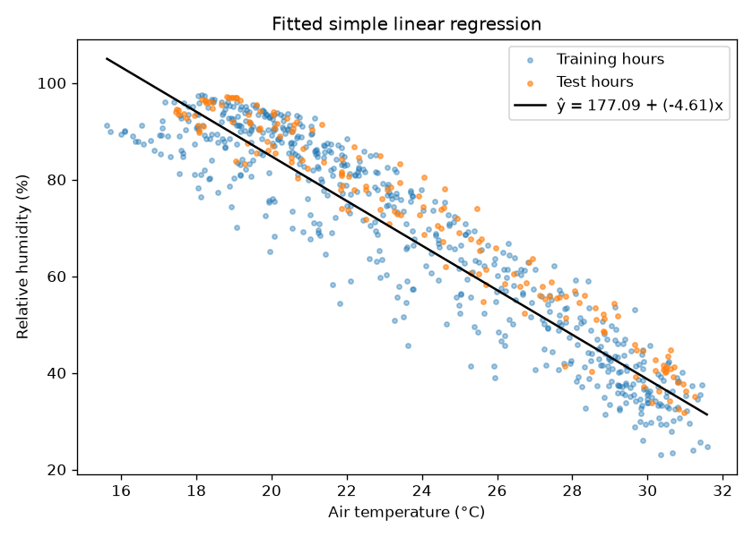

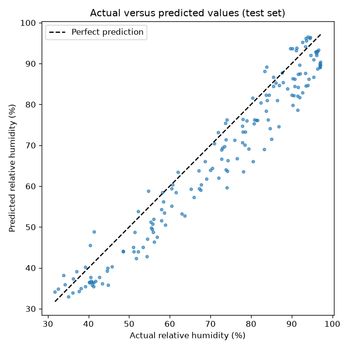

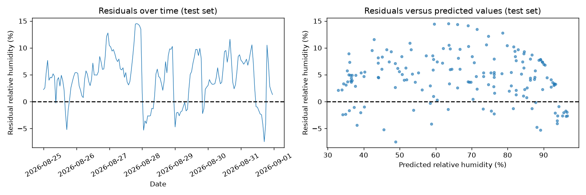

### 9.4 Interpretación crítica

1. **Utilidad frente a una referencia.** En la semana de prueba el modelo se equivoca en promedio 5,37 puntos de humedad, frente a 17,83 si se predijera siempre la media de entrenamiento: reduce el error absoluto en más de dos tercios. Esto, y no el valor de R² por sí solo, es la evidencia de que la temperatura aporta información real.
2. **Qué significa R².** R² = 0,899 indica que la suma de errores al cuadrado del modelo es aproximadamente un 10 % de la que se obtendría prediciendo la media de la semana de prueba. **No significa que el modelo "acierte el 90 %"** de las veces ni que tenga un 90 % de exactitud.
3. **Sesgo en la semana de prueba.** El residuo medio en prueba es **+4,42 puntos**, y el 81 % de los residuos son positivos: el modelo **subestima** la humedad de forma sistemática. A igual temperatura, la última semana fue más húmeda que las anteriores (humedad media de 71,20 % frente a 67,71 % en entrenamiento, con temperaturas medias parecidas: 23,91 °C frente a 23,71 °C). Con una sola variable el modelo no puede captar estos cambios (por ejemplo de masa de aire o de contenido de vapor); el dataset no incluye variables que permitan comprobar la causa. Es un sesgo, no un ruido aleatorio: si se restara el residuo medio, el R² de prueba subiría de 0,899 a 0,949 (cálculo sobre `test_predictions.csv`), coherente con que la correlación lineal en la semana de prueba (r = −0,975) es incluso más fuerte que en entrenamiento (r = −0,937).
4. **Prueba mejor que entrenamiento.** Que el R² de prueba (0,899) supere al de entrenamiento (0,878) no demuestra que el modelo "generalice mejor". La evidencia disponible apunta a que el periodo de entrenamiento incluye días difíciles para la recta: del 10 al 13 de agosto hay cuatro días seguidos con residuo medio diario muy negativo (entre −5,3 y −13,3 puntos: la humedad real fue menor que la estimada; ver sección 4.8), y el 2 de agosto también tuvo un residuo medio de −9,9. Al excluir esos cuatro días, el R² de entrenamiento sube a 0,900 y el MAE baja a 5,41. En cambio, excluir el 17 y 18 de agosto casi no modifica el R² (0,878). Además, la varianza de la humedad es menor en la semana de prueba (392,5 frente a 447,7), y el R² depende de esa variabilidad. Estos cálculos de diagnóstico se hicieron sobre los residuos del modelo y no forman parte de `results/tables/`.
5. **No linealidad cerca de la saturación.** En el gráfico de residuos frente a predicciones, los residuos tienden a ser negativos cuando la predicción supera ≈ 93 % (11 de las 12 horas de prueba, con residuo medio −1,97); en entrenamiento, con predicciones por encima de 92 % (60 horas) el residuo medio es −6,71. La recta además **no está acotada**: para temperaturas menores de 16,71 °C predice más del 100 %, cosa físicamente imposible. Esto ocurrió en 10 horas del entrenamiento y en ninguna de prueba (máximo predicho 96,58 %).
6. **Independencia de los errores.** La autocorrelación de lag 1 de los residuos es 0,82 en prueba: el error de una hora predice el de la siguiente. Se viola el supuesto de independencia, así que los intervalos de confianza clásicos de los coeficientes no serían fiables. Las métricas de error sí siguen siendo válidas como descripción del desempeño.
7. **¿Es útil?** Sirve para el objetivo planteado (estimación provisional y control de calidad del higrómetro), siempre que se tenga en cuenta un error típico de unos 5 a 6 puntos y cierto sesgo cuando cambian las condiciones de humedad de fondo. No sirve para pronosticar la humedad futura ni para aplicarse a otras estaciones sin volver a ajustarlo.

## 10. Conclusiones, limitaciones y complejidad computacional

**Conclusiones**

- El dataset tiene una estructura limpia y uniforme: 152 archivos con 8 columnas idénticas, sin duplicados y sin valores fuera de rango físico. El trabajo de limpieza consistió sobre todo en convertir tipos, quitar columnas redundantes y documentar los faltantes (4,57 %, un 61 % en el caso del CO).
- En las 14 estaciones meteorológicas, la temperatura y la humedad relativa tienen una relación lineal negativa fuerte (r de −0,88 a −0,94), coherente con la física de la saturación.
- La recta $\hat{y} = 177{,}09 - 4{,}61x$ (BAR-PDLA) estima la humedad de una semana no vista con MAE = 5,37 y RMSE = 6,27 puntos, mucho mejor que la referencia de la media (MAE = 17,83).
- El desarrollo manual con 8 registros reales reproduce exactamente el resultado de Python con esos mismos datos, y su pendiente (−4,66) es cercana a la del modelo completo (−4,61).

**Limitaciones**

- Se dispone de un solo mes (agosto), por lo que la estacionalidad no está representada.
- Se modela una sola estación, y el dataset no trae altitud ni coordenadas para explicar las diferencias entre estaciones.
- El único predictor deja sin explicar los cambios en el contenido de vapor, lo que produce sesgo en la semana de prueba.
- La relación no es lineal cerca del 100 %, y la recta puede predecir valores imposibles.
- Los residuos están autocorrelacionados, lo que viola el supuesto de independencia.
- La estación se eligió por tener la correlación más fuerte con datos completos (calculada solo con el 1–24 de agosto), pero la diferencia con las demás estaciones es pequeña (de −0,8845 a −0,9371); el resultado no debe extrapolarse a otras estaciones sin reajustar.
- Las estadísticas descriptivas, los valores atípicos y las gráficas exploratorias de la sección 4 usan las 744 horas (incluida la semana de prueba). Es un análisis descriptivo que no interviene en el ajuste, que solo usa el 1–24 de agosto, pero conviene tenerlo presente.
- El ejemplo manual usa valores redondeados a 2 decimales.

**Complejidad computacional**

- Entrenamiento: una pasada sobre los datos para obtener $\sum x$, $\sum y$, $\sum x^2$ y $\sum xy$, es decir, **O(n) en tiempo y O(1) en memoria adicional**. Con 576 registros es instantáneo.
- Predicción: **O(1) por registro** (una multiplicación y una suma).
- En la práctica, la parte costosa del proyecto es leer los 152 archivos Excel y reorganizar los datos, no el modelo.

**Cálculo manual frente a ejecución automática.** El cálculo manual hace visible cada suma y cada sustitución, pero solo es viable con pocos registros redondeados. Python aplica exactamente las mismas fórmulas a 576 registros sin redondear, en milisegundos y sin errores aritméticos. Por eso la verificación se hizo comparando ambos sobre los mismos datos: coeficientes en la sección 7.4 y métricas en la sección 9.2.

## 11. Referencias

- SIATA – Sistema de Alerta Temprana de Medellín y el Valle de Aburrá. *Datos validados, agosto de 2026* [conjunto de datos]. <https://siata.gov.co/IDEAM/DatosValidados_agosto2026.zip>. Consultado el 19/10/2026.
- Montgomery, D. C., Peck, E. A. y Vining, G. G. (2012). *Introduction to Linear Regression Analysis* (5.ª ed.). Wiley.
- James, G., Witten, D., Hastie, T. y Tibshirani, R. (2021). *An Introduction to Statistical Learning* (2.ª ed.). Springer.
- Wallace, J. M. y Hobbs, P. V. (2006). *Atmospheric Science: An Introductory Survey* (2.ª ed.). Academic Press.
- Documentación de pandas, NumPy y Matplotlib (bibliotecas usadas en la implementación).
